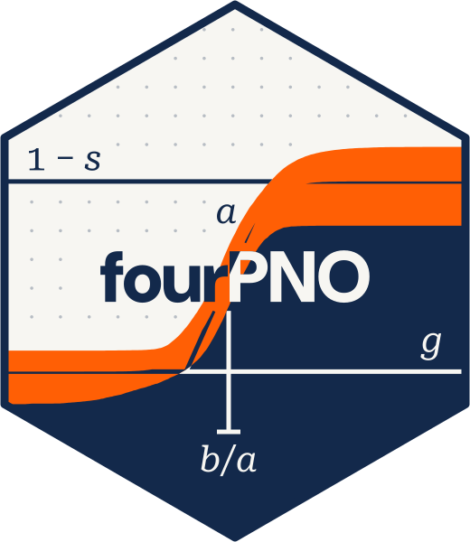

<!-- README.md is generated from README.qmd. Please edit that file -->

# fourPNO <a href="https://tmsalab.github.io/fourPNO/"><picture><source media="(prefers-color-scheme: dark)" srcset="man/figures/fourPNO-logo-animated-dark.svg"></picture></a>

<!-- badges: start -->

[](https://github.com/tmsalab/fourPNO/actions/workflows/R-CMD-check.yaml)
[-brightgreen.svg?style=flat)](http://www.gnu.org/licenses/gpl-2.0.html)
[](https://cran.r-project.org/package=fourPNO)
[](https://cran.r-project.org/web/checks/check_results_fourPNO.html)
[](https://www.r-pkg.org:443/pkg/fourPNO)
[](https://www.r-pkg.org:443/pkg/fourPNO)
<!-- badges: end -->

Estimate Barton & Lord’s (1981)
<https://doi.org/10.1002/j.2333-8504.1981.tb01255.x> four parameter IRT
model with lower and upper asymptotes using Bayesian formulation
described by Culpepper (2016)
<https://doi.org/10.1007/s11336-015-9477-6>.

## Installation

You can install `fourPNO` from CRAN using:

``` r
install.packages("fourPNO")
```

Or, you can be on the cutting-edge development version on GitHub using:

``` r
if(!requireNamespace("devtools")) install.packages("devtools")
devtools::install_github("tmsalab/fourPNO")
```

## Usage

To use the `fourPNO` package, load it into *R* using:

``` r
library("fourPNO")
```

Inside the package, the estimation routines can be viewed as:

- `Gibbs_2PNO()`
- `Gibbs_4PNO()`

## Author

Steven Andrew Culpepper

## Citing the `fourPNO` package

To ensure future development of the package, please cite `fourPNO`
package if used during an analysis or simulation study. Citation
information for the package may be acquired by using in *R*:

``` r
citation("fourPNO")
```

## License

GPL (\>= 2)
